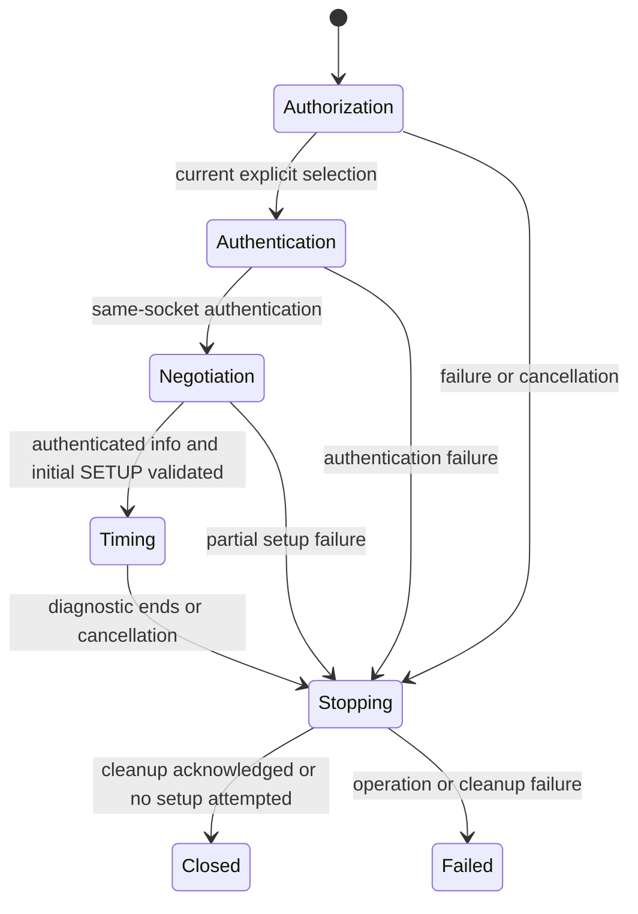

# Single-receiver buffered lifecycle: fail-closed foundation

> PR #43 update: see [current compatibility evidence, staged controls and remaining blockers](AIRPLAY2_COMPATIBILITY.md). The body below records the earlier foundation; its future-work statements are historical. Audio remains gated.

This change takes Prompt 42's explicit fallback: **live buffered playback remains
unavailable**. It implements an opt-in, authenticated initial PTP SETUP diagnostic
and its resource lifecycle. It does not implement or claim a complete playable
AirPlay 2 session. No physical receiver or hardware diagnostic was used in this
change. TCP delivery, a mock, RTSP 200 and peer timing activity cannot establish
verified audible playback.

## Architecture and states

`receiver/lifecycle.rs::Session` is the sole new buffered diagnostic owner. It
owns one authenticated `Wire`, one mandatory-authorized PR #41 `ptp::Service`,
one encrypted event worker, the session token, fresh random clock identity,
fresh UUID/URI and cancellation flag. It never owns or opens a media socket.
The existing `receiver/session.rs` realtime/NTP engine is preserved; its legacy
buffered entry point returns the same closed-gate reason.

Prebuffering, Playing and Paused are explicit reserved states. There is **no
legal transition into them**, including from Timing. No timer, successful
SETPEERS, anchor response, estimator result or caller-supplied boolean can open
this gate. Start/observe/stop on a stale owner is rejected; Drop cleanup is
idempotent. A fresh owner gets a fresh clock identity and UUID; media keys and
counters from another owner cannot enter this diagnostic because it has none.

Current sequence:

1. Require an exact receiver ID, current allowlist membership, persisted selection,
   explicitly selected authentication method and advertised buffered/PTP features.
2. Require terminal confirmation for `--setup-check`; revalidate the selected
   endpoint through `Wire::connect`. Never select, pair, downgrade or fall back.
3. Run existing persistent pair-verify or explicitly selected transient
   authentication on that same control connection. Transient authentication has
   its existing lack of persistent receiver identity assurance; it is not pairing.
4. Encrypted GET `/info`: require matching `deviceID`, buffered/PTP feature bits,
   non-conflicting authenticated ALAC24/48 kHz/stereo format ID 21 and a supported
   access policy. Do not use realtime-format checks to select buffered audio.
5. Send a bounded initial SETUP with fresh session UUID, PTP clock identity and
   local control address. The offer intentionally omits unvalidated group,
   clock-port-override and device-MAC assumptions. Its acceptance is unverified.
6. Require binary-plist SETUP, a valid event port, matching optional PTP protocol,
   zero optional legacy timingPort, no streams and timingPeerInfo containing a
   nonzero/non-reserved/non-local signed-64-bit ClockID and **only the exact
   authorized receiver IP**. Multiple timing addresses are rejected, never tried.
   Missing ClockID is an explicit blocker, never derived from UDP or device IDs.
7. Connect the encrypted event channel only to that receiver; attach mandatory
   authorized PTP event/general sockets on standard UDP 319/320. Bind failure is
   fatal. Poll for at most one second, checking authorization, event health and
   cancellation every iteration. Each PTP poll is bounded by PR #41's limits.
8. Stop PTP and events; attempt authenticated same-session TEARDOWN under a 250 ms
   request budget; close control and zeroize its owned cryptographic state.

Parameterized Session headers are deliberately unsupported by this diagnostic;
plain tokens are bounded, validated and pinned. Changed tokens are rejected.
Request and response plists, key bytes and samples are not logged.

## What the protocol evidence establishes

References were inspected for protocol facts, not used as an implementation
skeleton. No GPL code was copied, translated, vendored or linked. This is not a
claim of personnel-separated clean-room development. All new runtime code uses
existing Apache-compatible dependencies; reference files are outside the source
tree and are not build inputs.

| Pinned evidence | Established observation | Limit |
| --- | --- | --- |
| [owntone-mini minimal e9b058448b7d921ed048790b45614685fd13802b, airplay.c](https://github.com/lo-tech-systems/owntone-mini/blob/e9b058448b7d921ed048790b45614685fd13802b/src/outputs/airplay.c#L4623) | Initial PTP offer uses timingPeerInfo/ClockID/Addresses and timingPeerList; ClockID is a signed eight-byte plist integer. Initial response requires eventPort and timingPeerInfo. | Reference response path selects an address; that alone does not supply or prove receiver clock identity/adoption. PiAir requires a ClockID and exact address, so compatibility may be narrower. |
| [Same revision, sequence table](https://github.com/lo-tech-systems/owntone-mini/blob/e9b058448b7d921ed048790b45614685fd13802b/src/outputs/airplay.c#L6603) | Initial SETUP → event/PTP establishment → RECORD → SETPEERS → command tables → stream SETUP → audioMode; accepted rate anchor gates buffered media. Feedback and teardown are separate control sequences. | Sequence observed in an implementation is not receiver conformance. Command-table/audio-mode requirements and safe pause/flush semantics remain unvalidated for this sender. PiAir stops before RECORD. Volume operations in the reference are intentionally excluded. |
| [Independent openairplay receiver 6c343d3679ddb561c61566985acaaf587d0a3bd3](https://github.com/openairplay/airplay2-receiver/blob/6c343d3679ddb561c61566985acaaf587d0a3bd3/ap2-receiver.py#L221) | Independently corroborates timingPeerInfo/Addresses and initial/stream SETUP separation. Its timingPeerInfo example has no ClockID. RECORD returns informational latency; SETPEERS consumes a bare address array with `/peer-list-changed`; anchor rate 0/1 and rtpTime are recognized. | No proof of Apple receiver servo lock or authenticated adoption. Empty 200 is acceptance only. Missing ClockID cannot be repaired by assuming the device ID equals the PTP identity. |
| [PR #41 timing ledger](PTP_TIMING.md) and [PR #40 transport ledger](BUFFERED_TRANSPORT.md) | IEEE layouts, local clock model, full-precision anchors, independent plist/AEAD/ALAC fixtures, type103 framing and bounded TCP primitives. | Component correctness does not validate a complete receiver playback profile. |

The audited main was `280f5ef697da63dc6a86245d5f1b89df508f3053`, merging PR #41.
The audit included session, buffered, ptp, wire, planning, profile, compatibility,
pairing and their tests. Historical reference conclusions remain historical;
this ledger describes the new diagnostic's exact scope.

## Readiness criterion and unresolved blocker

PTP `PeerObserved` is liveness only. A grandmaster sees requests, not the remote
servo's offset. The standalone follower estimator cannot prove that this receiver
has adopted PiAir's grandmaster. Delay traffic, elapsed time and control 200s
must never be promoted to readiness.

Before enabling a complete lifecycle, independent protocol evidence must define
how to establish and continuously validate the receiver's adopted clock identity
and usable sample-to-clock mapping on the authenticated session, including Apple
signaling/TLV semantics if required. Evidence must distinguish remote adoption
from local estimator stability and quantify freshness/discontinuity bounds.
There is currently no supported mechanism supplying this evidence; readiness is
therefore **always false**. No fake production or test-only clock-lock override
is provided to make a mock playback lifecycle pass.

Even after that blocker is resolved, the owner must validate two-stage stream
SETUP, command/audio-mode exchanges, codec/encryption/streamConnectionID/ports,
SETPEERS and successful fresh SETRATEANCHORTIME before the first media byte.
It must own the existing ALAC24/type103/ChaCha20-Poly1305 components through one
revocable media path, service PTP during control and each write, and implement
bounded prebuffer, first-frame marker, starvation handling, feedback, anchor
renewal and pause/resume/flush with explicit sample/nonce continuity. None of
those operations is claimed implemented or tested end-to-end by this change.
No media connection or generated test tone is exposed while readiness is closed.

## Cleanup and security boundaries

SETUP is marked attempted before the request is sent. Semantic validation or
resource attachment failure after RTSP 200 therefore attempts TEARDOWN. If
control framing/authentication fails, Wire invalidates and closes the channel;
if approval is revoked, even TEARDOWN must not write. In either case authenticated
cleanup may be impossible. The error reports this, local resources are released,
and **remote session expiration is unconfirmed**. No client can guarantee remote
cleanup after network loss; do not report it acknowledged.

The PTP service is never active during control requests: it is attached after
SETUP and stopped before TEARDOWN. This prevents control stalls from starving
PTP in the implemented diagnostic. It is not the concurrency design for future
playback, which must continue PTP while RECORD, feedback, anchors and media run.

The existing event worker is the only new diagnostic-owned worker. Its Drop
closes its socket and joins; PTP has no worker thread. Control/event connection
attempts are bounded by existing three-second timeouts. Control requests use
existing cancellation polling and bounded request budgets, cleanup uses 250 ms,
and observation is at most one second. File-backed selection and approval are
rechecked before control operations and each PTP datagram. UDP timing is not
cryptographically authenticated; IP/identity/sequence binding cannot prevent
on-path spoofing. No additional peer, group or proxy is ever authorized.

## Safe, manual hardware instructions

Do not run these during tests, startup, installation or review automation.
Do not change OwnTone, Autostream, receiver volume or system services.

1. Build normally and inspect `piair buffered-test --help` locally.
2. Use the existing explicit allowlist/select workflow for one receiver. For
   persistent authentication, enroll credentials separately only if needed and
   explicitly authorized. The diagnostic never pairs or changes selection.
3. `piair buffered-test device:<your-12-lowercase-hex-digits>` fails locally with
   the timing blocker. `--confirm-audio` also fails locally before discovery or
   receiver connection; it cannot force playback.
4. Only when authorized to contact that receiver, invoke
   `piair --config <your-config> buffered-test device:<your-id> --setup-check`
   in a terminal and read/confirm its prompt. It performs initial SETUP only,
   one second of PTP observation, then bounded cleanup. Ctrl+C cancels it. It
   sends no audio and never changes volume. Standard PTP port bind permission
   may be required; failure is reported, with no port fallback or service edits.
5. Record firmware/model, whether ClockID was present, PTP activity, failure
   stage and TEARDOWN outcome. Never record keys or decrypted secret payloads.
   This establishes no playback compatibility or audible result.

A future audio diagnostic must require separate explicit transmission
confirmation, a short bounded duration, a faded conservative low-level original
tone and cancellation, without changing receiver volume. Those instructions
cannot be used to transmit audio in this revision.

## Verification and remaining PR #43 dependencies

New tests use explicit loopback authorizations and encrypted mock control
connections. They test initial request order/token continuity; identity, features,
codec conflicts, timing address/clock/port rejection; terminal/CLI closed gates;
partial SETUP failure; cancellation; PTP shutdown; approval revocation; disconnect;
Drop; bounded stalled TEARDOWN; fresh owner identity; and impossible transitions
into playing/paused/prebuffering. Existing authentication, type103 ALAC/nonce,
TCP stall/backpressure, anchor acceptance/staleness, PTP loss and realtime/NTP
tests remain required. These are component and diagnostic tests, not a mock proof
of full playback. Full playable lifecycle fault injection is deferred with the
closed live gate. Hardware was not contacted.

PR #43 group/proxy playback must wait for a complete validated single-receiver
lifecycle, reliable adoption/clock recovery, continuously revocable media grants,
feedback/flow-control and pause/flush semantics. It will additionally need
separate per-member authorization, topology provenance, leader/proxy role
negotiation, shared clock/sample mapping and coordinated failure/teardown.
No group expansion or group readiness inference is introduced here.
